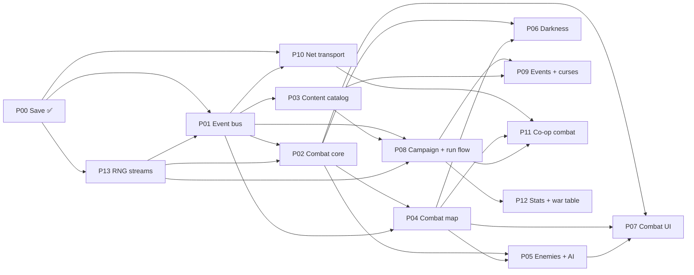

# Game Orchestrator

The living map of every implementation plan for Bandit Bash: what exists, what each plan depends on,
what may start next, and what stays out of scope. It keeps the project on the MVP and makes sure no
plan reaches implementation with a missing dependency.

**Created:** October 25, 2026. **Last updated:** October 26, 2026.

This is not an implementation plan (those use the template in
`docs/standards/gdscript-reference.md`). It has no work of its own; it tracks the plans that do.

## How to use this file

**Update it whenever** a plan is created, approved, started, finishes a step, or completes; a gate
opens; an unowned dependency gets an owner; or scope changes. Each update edits the
[Plan registry](#plan-registry), [Gates](#gates), [Next actions](#next-actions) and adds a line to the
[Change log](#change-log).

**Before a plan is approved**, check:

1. Every plan in its *Depends on* column is at least **Approved**, or the exact contract it uses is
   named in that plan's contracts section.
2. Its design basis has nothing it needs under "Still open" in
   [game-vision.md](../design/game-vision.md#open-and-unfinished).
3. Every [unowned dependency](#unowned-and-cross-cutting-dependencies) it touches has an owner.
4. It stays inside [MVP scope](#scope-guardrails), or the user has explicitly pulled the item in.

**Before an implementation step starts**, check its row in [Gates](#gates).

**Plan one step ahead.** A plan is drafted while the step before it is being built, never all at
once (plans written far ahead go stale) and never after the code that needs it (interfaces built
before their consumers are checked are the costliest to fix).

## Where we are

- **Design:** ideation closed for the MVP (design reviews of October 23–24, 2026). Remaining design
  items are content or tuning; see [Design items by plan](#design-items-by-plan).
- **Code:** the save system is built. P01 EB1 (facts and buses) is built and tested headless.
  Nothing gameplay-related is built yet.
- **Current milestone:** [M0 Foundations](#milestones).
- **Current focus:** P02 Combat core and P13 RNG streams are approved. Amend P01 with P02's needs (N1–N10) and P13's
  (R-N1–R-N4), then open EB2; P02 CC1 and P13 R1–R3 can run now.

## Milestones

The MVP is **one full run working, from the start screen to the boss, solo and co-op, on Normal**
(game-vision.md). Milestones build toward it so the first-pass numbers get playtested early.

| Milestone | Goal | Plans | Exit criteria |
|-----------|------|-------|---------------|
| **M0 Foundations** | The engine every gameplay system plugs into | P00, P01 | P00 implemented ✅; P01 EB1–EB7 implemented and verified headless |
| **M1 First playable fight** | One greybox standard combat, played start to finish, to test the core numbers | P02, P03 (starting army subset), P04 (one map), P05 (2–3 classes), P06, P07 (minimal) | A solo standard combat (Rout) with the Mercenary starting army vs a small Brigand pack, darkness included, playable with debug-grade UI; first tuning pass of Block, Stance, darkness, weight and turn par |
| **M2 Combat complete** | Every MVP combat feature and piece of combat content | P02–P07 complete | All objectives, map objects, the 10 enemy classes, 4 mini-bosses, the scripted Powder Baron map; all MVP units, weapons, staves, items, heirlooms and runes as data |
| **M3 Solo run** | A full solo run | P08, P09 | Start screen → campaign map → nodes → boss, solo, on Normal, saved and resumable; run length measured against 60–80 minutes |
| **M4 Co-op run** | The same run in co-op | P10, P11 | 2–4 players, parallel maps, reinforcements, disconnect and forfeit, per-map battle saves; tested live on two machines |
| **M5 MVP** | MVP complete | P12, polish | Statistics recording on; Waystation war table; MVP checklist in [Scope guardrails](#scope-guardrails) met |
| Post-MVP | Meta progression and beyond | P20–P24 | Not planned yet |

## Plan registry

Statuses: **Not started** · **Stub** · **Draft** · **Approved** · **In progress** (step shown) ·
**Implemented** · **Superseded**.

| ID | Plan | File | Status | Depends on | Unblocks | Design basis |
|----|------|------|--------|-----------|----------|--------------|
| P00 | Save system | [2026-10-13-save-system.md](2026-10-13-save-system.md) | **Implemented** October 14, 2026 (multiplayer paths untested live) | — | All | save-system.md |
| P01 | Event bus and effects | [2026-10-23-event-bus-and-effects.md](2026-10-23-event-bus-and-effects.md) | **In progress** (approved October 26, 2026): EB1 implemented; EB2 gated on P02 | P00 | Every gameplay plan | effects-system.md, effect-triggers.md |
| P02 | Combat core: turns and phases, action economy, the exchange, damage stages, Block, Stance, triangle, crits, Parry, Shove, staves, Pouch items, weapon swaps, runes, forecast, `CombatGrid` interface | [2026-10-26-combat-core.md](2026-10-26-combat-core.md) | **Approved** October 26, 2026 (reviewed: questions 9–12 answered, seven fixes). Implementation gated on P01 EB4; CC1 may start now (needs only EB1) | P01 (EB2–EB4, plus amendments N1–N10) | P04, P05, P06, P07 | game-vision.md Combat |
| P03 | Content catalog: unit types, traits and upgrades, the Drengr, prefixes, weapons, staves, items, ingredients, runes, heirlooms, curses | — | **Not started** (sketch before EB5; may split into units / items / heirlooms) | P01 (EB3, EB5) | M1 content, P08, P09 | unit-roster.md, weapons.md, items.md, heirlooms.md, events.md (curses) |
| P04 | Combat map: grid, terrain, pathing, deployment, objectives, reinforcement points, map objects, map authoring and its checks | — | **Not started** (draft before EB6) | P01 (EB6), P02 | P05, P06, P07, M1 | game-vision.md Combat maps, map-objects.md |
| P05 | Enemies and AI: classes, intents, danger zone, ruthless AI, signature moves, elites, mini-bosses, the Powder Baron | — | **Not started** | P02, P04 | M1, M2 | enemy-roster.md |
| P06 | The darkness | — | **Not started** | P02, P04 | M1 | the-darkness.md |
| P07 | Combat UI and forecast: forecast panel, move preview (darkness damage), danger zone and intent display, HUD | — | **Not started** (minimal version for M1) | P02, P04, P05 | M1, M2 | game-vision.md Combat, Enemy intentions |
| P08 | Campaign and run flow: `CampaignSession` ownership, campaign map generation, nodes, rewards, Armory, Guildhall, Camp, Treasure, gold, XP and level-ups, recruiting, run end | [2026-10-24-campaign-run-flow.md](2026-10-24-campaign-run-flow.md) | **Stub** (questions 1–2 gate EB6) | P01, P03 | M3, P09, P12 | game-vision.md Run structure, Army, Units |
| P09 | Narrative events and curses | — | **Not started** | P01, P03, P08 | M3 | events.md |
| P10 | Net transport: `Net` autoload, RPCs, command validation, Steam lobby integration | — | **Not started** | P00, P01 | P11 | multiplayer-combat-options.md, `steam_multiplayer_kit/` (read first) |
| P11 | Co-op combat: parallel maps, reinforcements, rune routing, spectating, fast-forward votes, disconnects and forfeits, per-map battle saves | — | **Not started** | P01 (EB6–EB7), P02, P04, P08, P10 | M4 | game-vision.md Multiplayer maps, multiplayer-combat-options.md |
| P12 | Statistics recording and the Waystation war table | — | **Not started** | P01, P08 | M5 | meta-progression.md (MVP parts) |
| P13 | RNG streams: run seed, named streams and their derivation, co-op stream layout, save and resume in the reserved `rng` sections, determinism rules | [2026-10-26-rng-streams.md](2026-10-26-rng-streams.md) | **Approved** October 26, 2026. R1–R3 may start now (pure; they unblock EB4); R4 needs only R1; R5 waits on P08 question 1 | P00 | P01 EB4/EB6, P02, P04, P05, P06, P08, P09, P11 | save-system.md (`rng` sections), P01 roll sources |
| P20 | Meta progression: unlocks, difficulty ladder, almanac, Hall of Heroes, run history, achievements, Waystation stations | — | Post-MVP | P12 | — | meta-progression.md |
| P21 | Training yard and tutorials | — | Post-MVP | P07 | — | meta-progression.md |
| P22 | Dev console | — | Post-MVP (scoped when needed) | P01 | — | meta-progression.md Developer tools |
| P23 | Status effects | — | Post-MVP | P01, P02 | — | game-vision.md Status effects |
| P24 | Shared and hybrid co-op battles (Option D) | — | Post-MVP | P11 | — | multiplayer-combat-options.md |

## Dependency graph

## Gates

Implementation steps that must wait for another plan. A gate opens when its condition is met;
mark it **Open** here.

| Step | Waits for | Why | Status |
|------|-----------|-----|--------|
| P01 EB1 Facts and buses | P01 approved | — | **Open** October 26, 2026; implemented |
| P01 EB2–EB4 Values, blocks, engine | P02 drafted and approved ✅ (October 26, 2026); P01 amended with P02's needs N1–N10 ([combat core plan](2026-10-26-combat-core.md#what-p02-needs-from-p01-eb2eb4)): exact float values, `EffectContext` fields, inline flags, permissions, expiry boundaries, per-map charges, 2RN and one-roll methods on roll sources, a sandbox hook for `CombatState`. The phase-side gap is settled by P02 step CC1 | Damage stages, stat sheets, forecasts, rolls and AI simulation sit on both sides | Closed: waiting on the P01 amendment |
| P01 EB5 Catalog and content tests | P03 sketched (content kinds, `res://data/` layout) | The catalog's typed lookups and layout follow the content kinds | Closed |
| P01 EB4 live rolls (within EB2–EB4) | P13 approved ✅ (October 26, 2026); P13 R1–R3 implemented (`RngStream` is what `LiveRolls` wraps); P01 amended with P13's needs R-N1 and R-N2 ([RNG plan](2026-10-26-rng-streams.md#what-p13-needs-from-other-plans)) | Real resolution and P02's golden-log tests need seeded streams | Closed: waiting on P13 approval and R1–R3 |
| P01 EB6 Sessions, encounter, bridge | P04 drafted (including P13 need R-N5: stable container indices); P08 question 1 (`CampaignSession` owner) answered; P13 approved and P01 amended with R-N3 (the encounter draws the whole setup once; sessions get their own streams) | Sessions carry turns, deployment, commands and the RNG injection point | Closed |
| P01 EB7 Serialization, rejoin | EB6; P01 amended with P13 need R-N4 (run seed, build and live stream states in snapshots and repro dumps) | — | Closed |
| P02 implementation | P01 EB4 implemented | Combat rules are effect-engine consumers | Closed |
| P03 implementation | P01 EB5 implemented | Content is catalog data | Closed |
| P04 implementation | P01 EB6, P02 core turn loop | Maps run inside sessions | Closed |
| P11 implementation | P10 implemented, P01 EB7, the per-map battle save format | Co-op needs transport, snapshots and saves | Closed |

## Unowned and cross-cutting dependencies

Things more than one plan needs that no plan clearly owns yet. Each needs an owner before the first
plan that depends on it is approved.

| Dependency | Needed by | Candidate owner | Status |
|------------|-----------|-----------------|--------|
| `CampaignSession` ownership and lifecycle | P01 EB6, P08, P11, P12 | P08 (question 1) | **Open** |
| RNG streams manager (reserved `rng` save keys in campaign and combat) | P01 EB4/EB6, P02, P04–P06, P08, P09, P11 | **P13** (its own plan; answers P08 question 2) | Owned October 26, 2026, not started |
| Modified-item price and scrap formula (from deltas) | P03, P08, P09 | P03 (items) or P08 (question 3) | **Open** |
| Per-map battle save format (one battle state per map) | P11 | P11 | Owned, not started |
| Forfeit save change (a campaign's player count can shrink) | P10, P11 | P11 | Owned, not started |
| Archive record gains run score and ladder level (schema bump and migration) | P12, P20 | P12 (score), P20 (ladder) | Owned, not started |
| Map authoring checks (≥ 8 deployment tiles, ≥ 2 darkness source candidates, ≤ 3 powder kegs) | P04, P06 | P04 (P06 adds its check) | Owned, not started |
| Design-doc updates from P01 (EB8: Campaign triggers, Block gained, inline windows) | P01 | P01 EB8 | Owned (per-map phases already written into the design docs October 24, 2026) |

## Design items by plan

Open design items that will need an answer when their plan is drafted. None blocks the MVP plans
from starting; each is asked inside its plan's Open Questions.

| Plan | Item | Source |
|------|------|--------|
| P03 | The Ring of Favor needs a Legendary-sized effect; Heavy Brick is Unique with no source; the Lancer's growths are a `Godot_FE` copy-paste; item effects may sit outside their ported rarity's budget | items.md, unit-roster.md |
| P04 / P06 | Turn par and reinforcement timers per map are set when maps are authored; darkness values on small maps need M1 playtesting | game-vision.md, the-darkness.md |
| P05 | The Brigands' real name and theme (flavor only) | enemy-roster.md |
| P07 | `Godot_FE`'s ranged multi-tile forecast defect (FR-GRID-6) to investigate | P01 contracts |
| P11 | Light links beyond runes on a teammate's map | multiplayer-combat-options.md |

## Scope guardrails

**In the MVP** (game-vision.md): one act, one faction (Mercenary), one commander (the Drengr), Normal
only, the 14 MVP unit types, 10 enemy classes, 4 mini-bosses, the Powder Baron, the full item,
weapon, heirloom, rune and event pools, the darkness, solo and co-op on parallel maps, statistics
recording and the Waystation war table.

**Out of the MVP** (stop and ask before any plan touches these): meta progression (unlocks, the
difficulty ladder, almanac, Hall of Heroes, run history, achievements, the other Waystation
stations), endless runs and later acts, more bosses, the Mage Tower and Kingdom factions and the
other commanders, status effects and status staves, the Ballista and War Drum, darkness extras
beyond the Brazier, support weapons beyond staves, one- and two-handed weapons, unique equipment,
more enemy factions, units with convoy access, shared and hybrid co-op battles, the dev console.

**Focus rules**

- A plan that grows past its row's scope splits into a new row here, not a bigger plan.
- A gameplay value with no basis in the design docs or `Godot_FE/` is a design question, not an
  implementation choice: it goes back to the design docs first (CLAUDE.md §1).
- M1 comes before breadth: content beyond the M1 subset waits until the first playable fight has
  been tuned once.

## Next actions

1. Amend P01 with P02's needs N1–N10 and P13's needs R-N1–R-N4, then open the EB2–EB4 gate.
2. P02 step CC1 (fact amendments: `side`, seven kinds including `BLOCK_LOST`, `Source.SPIKE`, the
   turn in `PHASE_START`) can run now: it only needs EB1.
3. Build P13 R1–R3 (keys and mixer, streams, registry; pure, no gate) before EB4; R4 (run seed) after R1.
4. Answer P08 question 1 (`CampaignSession` owner) before EB6; question 2 is answered by P13.
5. Sketch P03 before EB5; draft P04 before EB6 (P04 implements P02's `CombatGrid`).

## Change log

| Date | Change |
|------|--------|
| October 25, 2026 | Created. Registered P00–P12 and post-MVP P20–P24, milestones M0–M5, step gates for P01, unowned dependencies and scope guardrails. |
| October 26, 2026 | P01 approved; EB1 gate opened and EB1 implemented (51 headless tests pass). Fact contract settled: paired triggers as two facts, `CombatFact.DamageType`, effect-instance ids in `source_effect_id`, minimal `CampaignFact`. Phase-side gap handed to P02. |
| October 26, 2026 | P02 Combat core drafted, 8 questions answered (bonus turns uncapped, exact-then-round-once damage, one-roll crits, `Godot_FE` counter rule, shove only if it does something; grid interface, all non-map actions, ordered turn-loop hooks). Its 10 needs from P01 added as the EB2 gate condition. Vision updated (bonus turns, terrain DEF/RES in mitigation). |
| October 26, 2026 | P13 RNG streams registered (the unowned RNG manager); gates EB4 (stream interface) and EB6 (injection); answers P08 question 2. |
| October 26, 2026 | P13 RNG streams drafted: keyed per node and running within, shared world with per-seat rewards and event outcomes (chest loot per seat), Godot PCG32 with our SplitMix64 key derivation, 52-bit run seed shown and debug-enterable, same-build determinism. Its save sections wait on P08 question 1. |
| October 26, 2026 | P13 readiness check: fixed a co-op divergence (shared streams are drawn once at setup, reinforcement waves pre-drawn), corrected the `BATTLE_RETRY` mechanism (streams re-derived from keys), and listed P13's needs from P01, P04 and P08 (R-N1–R-N6); EB4 and EB6 gates now include them. |
| October 26, 2026 | P02 review: Unit Turn Start moved into the Phase Start window (per unit, after refresh and Phase Start effects, before control, as `Godot_FE`'s beginning phase); Breaker's extra Stance loss only when damage gets through. Fixes: units start with full Stance when placed; movement cost for "remaining movement" and a `MOVEMENT` key; Spark through a P04 `OBJECT_OPERATIONS` hook and Recall as a P02 operation; Attack Speed and Pouch weight stated; mid-phase save fields; `ExchangeOutcome` owned by P01 only; `BLOCK_LOST` fact kind; RNG ownership pointed at P13. Question 11 (Unit Turn End) open. Vision and effect-triggers.md updated. |
| October 26, 2026 | P02 question 11 answered: Unit Turn End fires per unit in the Phase End window, mirroring Unit Turn Start. P02 has no open questions and is ready for approval. |
| October 26, 2026 | **P02 Combat core approved.** CC1 (fact amendments) may start now; the rest of P02 waits on P01 EB4. Next: amend P01 with N1–N10 and R-N1–R-N4 to open EB2–EB4. |
| October 26, 2026 | P02 approval verified against the orchestrator checklist (dependencies, design basis, unowned dependencies, scope): approval holds. Question 12 added: Phase End and Unit Turn End effects resolve before darkness damage (vision, the-darkness.md and the plan updated). |
| October 26, 2026 | **P13 RNG streams approved** after review fixes: `TEAM_CHOICE` purpose for team-vote draws, per-seat `ENCOUNTER_SETUP` for per-player additions (Hunted), SplitMix64 in 16-bit limbs with masked shifts, integer weights, starting-heirloom follow-up draws. Rule added to `.claude/rules/gdscript.md` §8.5 (gameplay randomness only from an `RngStream`). R1–R3 may start now. |
