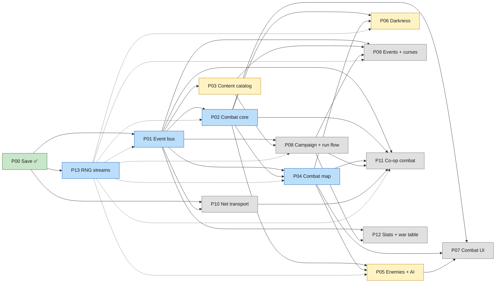
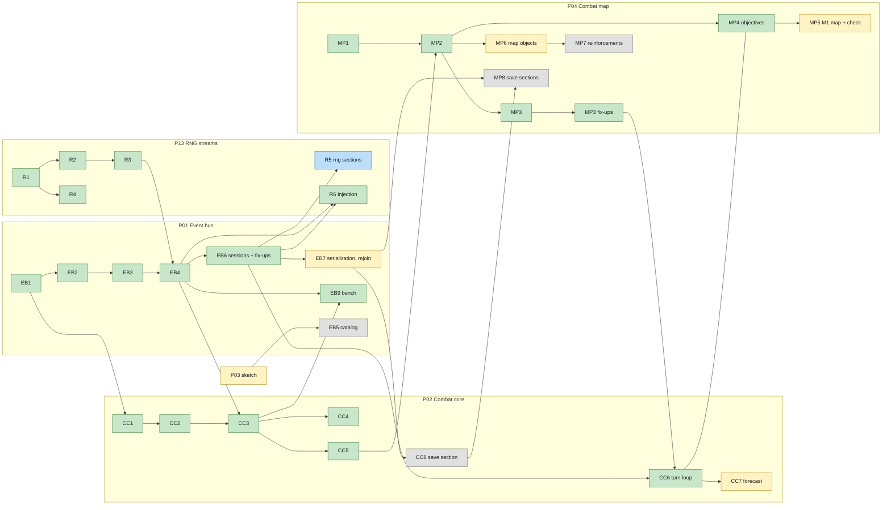

# Game Orchestrator

The living map of every implementation plan for Bandit Bash: what exists, what each plan depends on,
what may start next, and what stays out of scope. It keeps the project on the MVP and makes sure no
plan reaches implementation with a missing dependency.

**Created:** October 25, 2026. **Last updated:** October 28, 2026.

This is not an implementation plan (those use the template in
`docs/standards/gdscript-reference.md`). It has no work of its own; it tracks the plans that do.

## How to use this file

**Update it whenever** a plan is created, approved, started, finishes a step, or completes; a gate
opens; an unowned dependency gets an owner; or scope changes. Each update edits the
[Plan registry](#plan-registry), [Gates](#gates), [Next actions](#next-actions), the status colors
and edges of both [dependency graphs](#dependency-graph), and adds a line to the
[Change log](#change-log).

**Before a plan is approved**, check:

1. Every plan in its *Depends on* column is at least **Approved**, or the exact contract it uses is
   named in that plan's contracts section.
2. Its design basis has nothing it needs under "Still open" in
   [game-vision.md](../design/game-vision.md#open-and-unfinished).
3. Every [unowned dependency](#unowned-and-cross-cutting-dependencies) it touches has an owner.
4. It stays inside [MVP scope](#scope-guardrails), or the user has explicitly pulled the item in.

**Before an implementation step starts**, check its row in [Gates](#gates).

**Plan one step ahead.** A plan is drafted while the step before it is being built, never all at
once (plans written far ahead go stale) and never after the code that needs it (interfaces built
before their consumers are checked are the costliest to fix).

**Branches:** build tracks branch from `dev` as `feature/<step>` (e.g. `feature/EB9`) and merge back
into `dev`; plan and orchestrator commits go to `dev`; `main` holds released state (since October 27,
2026).

## Where we are

- **Design:** ideation closed for the MVP (design reviews of October 23–24, 2026). Remaining design
  items are content or tuning; see [Design items by plan](#design-items-by-plan).
- **Code:** the save system is built and on `main`. On `dev`, built, tested headless and merged:
  - P01: EB1–EB4, EB6 (with its fix-ups) and EB9;
  - P02: CC1–CC6;
  - P04: MP1–MP4 (with the MP3 fix-ups);
  - P13: R1–R4 and R6.

  Tests passing (with a test user folder): sessions 178, map 293, combat 525, effects 521, RNG 154
  and save 204. The combat rules (exchange, splash, Shove, staves, Pouch items, swaps, runes) run
  in tests. Battles run inside sessions, with setup, commands, grants and transfers between maps,
  and now a turn loop: phases and hooks, unit turns, end turn, runes, the enemy phase as one
  command (every enemy Waits until P05's AI), the optional opening swap with Start, and
  objectives that end each map with `COMBAT_ENDED`.
- **Current milestone:** [M0 Foundations](#milestones); only EB7 remains of its exit criteria
  (EB5 waits on P03).
- **Current focus:** the road to M1's first playable fight: P04 MP5 (the M1 greybox map and its
  check) and P02 CC7 (forecast), with P04 MP6, P13 R5 and P01 EB7 alongside. Planning, one step
  ahead: sketch P03, then draft P05 (the AI M1 needs) and P06 (both depend only on P02 and P04,
  which are approved).

## Milestones

The MVP is **one full run working, from the start screen to the boss, solo and co-op, on Normal**
(game-vision.md). Milestones build toward it so the first-pass numbers get playtested early.

| Milestone | Goal | Plans | Exit criteria |
|-----------|------|-------|---------------|
| **M0 Foundations** | The engine every gameplay system plugs into | P00, P01 | P00 implemented ✅; P01 EB1–EB7 implemented and verified headless |
| **M1 First playable fight** | One greybox standard combat, played start to finish, to test the core numbers | P02, P03 (starting army subset), P04 (one map), P05 (2–3 classes), P06, P07 (minimal) | A solo standard combat (Rout) with the Mercenary starting army vs a small Brigand pack, darkness included, playable with debug-grade UI; first tuning pass of Block, Stance, darkness, weight and turn par |
| **M2 Combat complete** | Every MVP combat feature and piece of combat content | P02–P07 complete | All objectives, map objects, the 10 enemy classes, 4 mini-bosses, the scripted Powder Baron map; all MVP units, weapons, staves, items, heirlooms and runes as data |
| **M3 Solo run** | A full solo run | P08, P09 | Start screen → campaign map → nodes → boss, solo, on Normal, saved and resumable; run length measured against 60–80 minutes |
| **M4 Co-op run** | The same run in co-op | P10, P11 | 2–4 players, parallel maps, reinforcements, disconnect and forfeit, per-map battle saves; tested live on two machines |
| **M5 MVP** | MVP complete | P12, polish | Statistics recording on; Waystation war table; MVP checklist in [Scope guardrails](#scope-guardrails) met |
| Post-MVP | Meta progression and beyond | P20–P24 | Not planned yet |

## Plan registry

Statuses: **Not started** · **Stub** · **Draft** · **Approved** · **In progress** (step shown) ·
**Implemented** · **Superseded**.

| ID | Plan | File | Status | Depends on | Unblocks | Design basis |
|----|------|------|--------|-----------|----------|--------------|
| P00 | Save system | [2026-10-13-save-system.md](2026-10-13-save-system.md) | **Implemented** October 14, 2026 (multiplayer paths untested live) | — | All | save-system.md |
| P01 | Event bus and effects | [2026-10-23-event-bus-and-effects.md](2026-10-23-event-bus-and-effects.md) | **In progress** (approved October 26, 2026; amended with P02's and P13's needs the same day): EB1–EB4 implemented with fixes F1–F12; EB9 implemented (results in P01); EB6 implemented October 28, 2026 with its fix-ups (questions 40–49); EB7 ready; EB5 waits on P03 | P00 | Every gameplay plan | effects-system.md, effect-triggers.md |
| P02 | Combat core: turns and phases, action economy, the exchange, damage stages, Block, Stance, triangle, crits, Parry, Shove, staves, Pouch items, weapon swaps, runes, forecast, `CombatGrid` interface | [2026-10-26-combat-core.md](2026-10-26-combat-core.md) | **Approved** October 26, 2026 (reviewed: questions 9–12 answered, seven fixes). **In progress:** CC1–CC6 built and merged (CC6 with P04 MP4, October 28, 2026; 525 headless combat tests pass); CC7 ready; CC8 after EB7; no open questions (14: range 0 is self; 17: the opening swap is a setting, its window before turn 1 closed by Start; 18: CC6 part 1 choices accepted) | P01 (EB2–EB4, plus amendments N1–N10) | P04, P05, P06, P07 | game-vision.md Combat |
| P03 | Content catalog: unit types, traits and upgrades, the Drengr, prefixes, weapons, staves, items, ingredients, runes, heirlooms, curses | — | **Not started** (sketch before EB5; may split into units / items / heirlooms) | P01 (EB3, EB5) | M1 content, P08, P09 | unit-roster.md, weapons.md, items.md, heirlooms.md, events.md (curses) |
| P04 | Combat map: grid, terrain, pathing, deployment, objectives, reinforcement points, map objects, map authoring and its checks | [2026-10-27-combat-map.md](2026-10-27-combat-map.md) | **Approved** October 27, 2026 (13 questions answered; "within N movable tiles" cut; no prep screen); **In progress:** MP1–MP4 built and merged October 28, 2026, with the MP3 fix-ups (MP4 with P02 CC6; 293 headless map tests pass); MP5 and MP6 ready; MP7 after MP6, MP8 after EB7 and CC8 | P01 (EB6), P02 | P05, P06, P07, M1 | game-vision.md Combat maps, map-objects.md |
| P05 | Enemies and AI: classes, intents, danger zone, ruthless AI, signature moves, elites, mini-bosses, the Powder Baron | — | **Not started** | P02, P04 | M1, M2 | enemy-roster.md |
| P06 | The darkness | — | **Not started** | P02, P04 | M1 | the-darkness.md |
| P07 | Combat UI and forecast: forecast panel, move preview (darkness damage), danger zone and intent display, HUD | — | **Not started** (minimal version for M1) | P02, P04, P05 | M1, M2 | game-vision.md Combat, Enemy intentions |
| P08 | Campaign and run flow: `CampaignSession` ownership, campaign map generation, nodes, rewards, Armory, Guildhall, Camp, Treasure, gold, XP and level-ups, recruiting, run end | [2026-10-24-campaign-run-flow.md](2026-10-24-campaign-run-flow.md) | **Stub** (question 1 answered: `CampaignService`, built in EB6; question 2 answered by P13). Applies the grants `CampaignSession` records (P01 question 43) | P01, P03 | M3, P09, P12 | game-vision.md Run structure, Army, Units |
| P09 | Narrative events and curses | — | **Not started** | P01, P03, P08 | M3 | events.md |
| P10 | Net transport: `Net` autoload, RPCs, command validation, Steam lobby integration | — | **Not started** | P00, P01 | P11 | multiplayer-combat-options.md, `steam_multiplayer_kit/` (read first) |
| P11 | Co-op combat: parallel maps, reinforcements, rune routing, spectating, fast-forward votes, disconnects and forfeits, per-map battle saves | — | **Not started** | P01 (EB6–EB7), P02, P04, P08, P10 | M4 | game-vision.md Multiplayer maps, multiplayer-combat-options.md |
| P12 | Statistics recording and the Waystation war table | — | **Not started** | P01, P08 | M5 | meta-progression.md (MVP parts) |
| P13 | RNG streams: run seed, named streams and their derivation, co-op stream layout, save and resume in the reserved `rng` sections, determinism rules | [2026-10-26-rng-streams.md](2026-10-26-rng-streams.md) | **In progress** (approved October 26, 2026): R1–R4 built and merged (154 headless tests pass); R6 built with P01 EB4 and EB6; R5 in progress (`feature/R5`, in its own worktree, prompt issued October 28, 2026; it registers from `CampaignService`, built in EB6) | P00 | P01 EB4/EB6, P02, P04, P05, P06, P08, P09, P11 | save-system.md (`rng` sections), P01 roll sources |
| P20 | Meta progression: unlocks, difficulty ladder, almanac, Hall of Heroes, run history, achievements, Waystation stations | — | Post-MVP | P12 | — | meta-progression.md |
| P21 | Training yard and tutorials | — | Post-MVP | P07 | — | meta-progression.md |
| P22 | Dev console | — | Post-MVP (scoped when needed) | P01 | — | meta-progression.md Developer tools |
| P23 | Status effects | — | Post-MVP | P01, P02 | — | game-vision.md Status effects |
| P24 | Shared and hybrid co-op battles (Option D) | — | Post-MVP | P11 | — | multiplayer-combat-options.md |

## Dependency graph

Two views, both updated with every status change: plans (edges follow the registry's *Depends on*
column) and the build steps of the plans in progress. Colors: **green** implemented · **blue** in
progress · **yellow** ready to start (or to draft) · **grey** waiting · **white** post-MVP or not
yet planned.

### Plans

Dotted edges are P13's streams: every plan that rolls draws through them.

### Build steps in progress

Docs steps (EB8, CC9, MP9, R7) are left out. An edge from outside a plan's box is a gate in
[Gates](#gates).

`CC6 --- MP4`: built together; MP4's objective checks run on CC6's `AFTER_STEP` hook.

## Gates

Implementation steps that must wait for another plan. A gate opens when its condition is met;
mark it **Open** here.

| Step | Waits for | Why | Status |
|------|-----------|-----|--------|
| P01 EB1 Facts and buses | P01 approved | — | **Open** October 26, 2026; implemented |
| P01 EB2–EB4 Values, blocks, engine | P02 drafted and approved ✅ (October 26, 2026); P01 amended with P02's needs N1–N10 ([combat core plan](2026-10-26-combat-core.md#what-p02-needs-from-p01-eb2eb4)): exact float values, `EffectContext` fields, inline flags, permissions, expiry boundaries, per-map charges, 2RN and one-roll methods on roll sources, a sandbox hook for `CombatState`. The phase-side gap is settled by P02 step CC1. P01 amended ✅ (October 26, 2026; [Amendments from P02 and P13](2026-10-23-event-bus-and-effects.md#amendments-from-p02-and-p13), P01 questions 17–18) | Damage stages, stat sheets, forecasts, rolls and AI simulation sit on both sides | **Open** October 26, 2026 (EB2 and EB3 built; EB4 also needed the live-rolls row below, now open) |
| P01 EB5 Catalog and content tests | P03 sketched (content kinds, `res://data/` layout) | The catalog's typed lookups and layout follow the content kinds | Closed |
| P01 EB4 live rolls (within EB2–EB4) | P13 approved ✅ (October 26, 2026); P13 R1–R3 implemented ✅ (`RngStream` is what `LiveRolls` wraps); P01 amended with P13's needs R-N1 and R-N2 ✅ (October 26, 2026) ([RNG plan](2026-10-26-rng-streams.md#what-p13-needs-from-other-plans)) | Real resolution and P02's golden-log tests need seeded streams | **Open** October 26, 2026 (R1–R3 built) |
| P01 EB6 Sessions, encounter, bridge | P04 approved ✅ (October 27, 2026; including P13 need R-N5: stable container indices); P08 question 1 (`CampaignSession` owner) answered ✅ (October 27, 2026: `CampaignService`); P13 approved and P01 amended with R-N3 ✅ (the encounter draws the whole setup once; sessions get their own streams) | Sessions carry turns, deployment, commands and the RNG injection point | **Open** October 27, 2026; implemented with fix-ups October 28, 2026 |
| P01 EB7 Serialization, rejoin | EB6; P01 amended with P13 need R-N4 ✅ (run seed, build and live stream states in snapshots and repro dumps) | — | **Open** October 28, 2026 (EB6 implemented) |
| P02 implementation (CC2–CC7; CC6 waits on EB6) | P01 EB4 implemented ✅ (October 26, 2026); EB6 implemented ✅ (October 28, 2026), so CC6 may start | Combat rules are effect-engine consumers | **Open** October 26, 2026; CC2–CC5 built October 27, 2026; CC6 built October 28, 2026, so CC7 may start |
| P01 EB9 Benchmark | P02 CC3 (a real `CombatState` and exchange to measure) | Sandbox creation cost means little on the fake test state; the numbers decide copy on write and the AI's branch budget | **Open** October 27, 2026 (CC3 built); implemented October 27, 2026 |
| P02 CC8 Save section | P01 EB7 | `combat_state` capture builds on EB7's capture and restore helpers | Closed |
| P13 R5 `rng` save sections | P08 question 1 ✅; P01 EB6 implemented ✅ (October 28, 2026; `CampaignService` registers them) | The sections belong to the autoload that owns the streams | **Open** October 28, 2026 |
| P03 implementation | P01 EB5 implemented | Content is catalog data | Closed |
| P04 MP1–MP3, MP6 | P04 approved ✅ (October 27, 2026) | — | **Open** October 27, 2026; MP1–MP3 built October 28, 2026 |
| P04 MP4 Objectives | P02 CC6 (the `AFTER_STEP` hook) | The checks run on the turn loop's hook; built with CC6 | **Open** October 28, 2026 (EB6 implemented, so CC6 may start); implemented with CC6 October 28, 2026, so MP5 may start |
| P04 MP8 Save sections | P01 EB7, P02 CC8 | `entities` and `combat_map` follow the session snapshot and `combat_state` | Closed |
| P11 implementation | P10 implemented, P01 EB7, the per-map battle save format | Co-op needs transport, snapshots and saves | Closed |

## Unowned and cross-cutting dependencies

Things more than one plan needs that no plan clearly owns yet. Each needs an owner before the first
plan that depends on it is approved.

| Dependency | Needed by | Candidate owner | Status |
|------------|-----------|-----------------|--------|
| `CampaignSession` ownership and lifecycle | P01 EB6, P08, P11, P12 | P08 (question 1): the `CampaignService` autoload, built in P01 EB6 | **Owned** October 27, 2026 |
| RNG streams manager (reserved `rng` save keys in campaign and combat) | P01 EB4/EB6, P02, P04–P06, P08, P09, P11 | **P13** (its own plan; answers P08 question 2) | Owned October 26, 2026, not started |
| Modified-item price and scrap formula (from deltas) | P03, P08, P09 | P03 (items) or P08 (question 3) | **Open** |
| Per-map battle save format (one battle state per map) | P11 | P11 | Owned, not started |
| Forfeit save change (a campaign's player count can shrink) | P10, P11 | P11 | Owned, not started |
| Archive record gains run score and ladder level (schema bump and migration) | P12, P20 | P12 (score), P20 (ladder) | Owned, not started |
| Map authoring checks (≥ 8 deployment tiles, ≥ 2 darkness source candidates, ≤ 3 powder kegs) | P04, P06 | P04 (P06 adds its check) | Owned, not started |
| Design-doc updates from P01 (EB8: Campaign triggers, Block gained, inline windows) | P01 | P01 EB8 | Owned (per-map phases already written into the design docs October 24, 2026) |

## Design items by plan

Open design items that will need an answer when their plan is drafted. None blocks the MVP plans
from starting; each is asked inside its plan's Open Questions.

| Plan | Item | Source |
|------|------|--------|
| P03 | The Ring of Favor needs a Legendary-sized effect; Heavy Brick is Unique with no source; the Lancer's growths are a `Godot_FE` copy-paste; item effects may sit outside their ported rarity's budget; Brothers in Arms needs a selector filter ("adjacent to a unit of another player") the engine doesn't have (P01 question 30); the content test rejects a staff or weapon with no range, and an attack (weapon or attack staff) with range 0 (P02 question 14); say which rune is Recall, or let a rune declare that it targets a second unit (CC6 treats any cast naming a second unit as Recall until then, P02 question 18); mark shove specialists in unit data, so auto-deployment reads the Shover from it instead of the Ward's type name (`auto_deploy.gd:TOD-001`) | items.md, unit-roster.md, heirlooms.md, weapons.md |
| P08 | Personal XP for "gave Block" ignores `BLOCK_GAINED` facts with amount 0 (P01 question 24) | P01 |
| P08 | Re-gearing at Camps (user, October 27, 2026: no combat has a prep screen; the map before the boss has a Camp); decide whether army management stays available anywhere else on the campaign map, given the goal of less menuing | P04 question 4 |
| P04 / P06 | Turn par and reinforcement timers per map are set when maps are authored; darkness values on small maps need M1 playtesting | game-vision.md, the-darkness.md |
| P07 / P08 | Show the run seed on the pause screen (P07) and the results screen (P08), formatted by `RunSeed.format()` (P13 R4 follow-up) | P13 |
| P07 | The opening-swap setting (P02 question 17): an options-menu toggle, per player, saved with the player's settings (state the `PlayerSaveSection` impact); its default (assumed **on** until decided, for casual players); what the swap window shows before turn 1 (danger zone; intents only exist after Start, unless P05 previews them) | P02 question 17 |
| P12 | Whether runs abandoned by the save debug panel's "New Solo Run From Seed" count as lost runs in statistics | P13 R4 |
| P04 | Tile coordinates are never negative (P01 question 37, `CombatFact.NO_TILE`); `MapCheck` enforces it (MP5). ("Within N movable tiles" was cut October 27, 2026.) | P01 |
| P05 | The Brigands' real name and theme (flavor only) | enemy-roster.md |
| P05 | The AI's branch budget and whether sandboxes become copy on write or lazy, from P01 EB9's results (exact `ExchangeOutcome` is about 2 ms per branch; one exchange reads 2–3 of 11 units); measure a release build first | P01 EB9 |
| P07 | `Godot_FE`'s ranged multi-tile forecast defect (FR-GRID-6) to investigate | P01 contracts |
| P11 | Light links beyond runes on a teammate's map | multiplayer-combat-options.md |
| P11 | A unit sent to a partner's map loses its timed modifiers (Momentum and the like); carry them with the unit | P01 question 49 |
| P11 | A player's "Your Unit" heirlooms don't follow their unit onto a partner's map; players will likely expect them to keep working | P01 question 49 |
| P11 | Cross-map delivery: a cross-map effect's queued operations resolve on the map where it triggered, so "Your Units" never reaches the owner's map; build the engine's forwarding hook when content needs it | P01 question 44 |
| Vision (ideation thread) | Pending updates from the October 27 orchestrator decisions: turn par is set by hand per map with no target range, small combats well below the current figures (which also disagree: boss "14–18" vs "10–14", ladder −1 vs "Hard −1"); no battle prep in any combat, automatic deployment with an optional opening swap (a player setting, like Pokémon's Set / Shift: on, the battle opens in a swap window closed by a Start press; off, it starts at once); Camps allow re-gearing ("gear moves only in army management and battle prep" and Camp's "choose one" change); "within N movable tiles" cut; weapons.md lists Everwall's range as "—", which becomes 0 (self), with a note that every staff and weapon has a range (October 28 decision) | P04 questions 4 and 12, P02 question 14 |

## Scope guardrails

**In the MVP** (game-vision.md): one act, one faction (Mercenary), one commander (the Drengr), Normal
only, the 14 MVP unit types, 10 enemy classes, 4 mini-bosses, the Powder Baron, the full item,
weapon, heirloom, rune and event pools, the darkness, solo and co-op on parallel maps, statistics
recording and the Waystation war table.

**Out of the MVP** (stop and ask before any plan touches these): meta progression (unlocks, the
difficulty ladder, almanac, Hall of Heroes, run history, achievements, the other Waystation
stations), endless runs and later acts, more bosses, the Mage Tower and Kingdom factions and the
other commanders, status effects and status staves, the Ballista and War Drum, darkness extras
beyond the Brazier, support weapons beyond staves, one- and two-handed weapons, unique equipment,
more enemy factions, units with convoy access, shared and hybrid co-op battles, the dev console.

**Focus rules**

- A plan that grows past its row's scope splits into a new row here, not a bigger plan.
- A gameplay value with no basis in the design docs or `Godot_FE/` is a design question, not an
  implementation choice: it goes back to the design docs first (CLAUDE.md §1).
- M1 comes before breadth: content beyond the M1 subset waits until the first playable fight has
  been tuned once.

## Next actions

1. **Build P04 MP5** (the M1 greybox map, `MapMarker` nodes, `MapCheck`) and **P02 CC7**
   (forecast and the AI summary): the critical path to M1, now that CC6 and MP4 are in.
2. **Alongside, on separate branches:**
   - P04 MP6 (map objects and the container-contents field; once the user confirms them, it
     also removes the four MP1/MP2 `ASSUMPTION` markers);
   - P13 R5 (`rng` sections from `CampaignService`, in progress);
   - P01 EB7 (serialization, rejoin), branched from `dev` now that CC6 is merged.
3. **After them:** MP7 after MP6; CC8 after EB7; MP8 after CC8.
4. **Plan one step ahead:** sketch P03 (content catalog, which opens EB5), then draft P05 (enemies
   and AI) and P06 (the darkness). Both depend only on P02 and P04, which are approved.
5. Vision updates pending for the ideation thread (Design items by plan).

## Change log

| Date | Change |
|------|--------|
| October 25, 2026 | Created. Registered P00–P12 and post-MVP P20–P24, milestones M0–M5, step gates for P01, unowned dependencies and scope guardrails. |
| October 26, 2026 | P01 approved; EB1 gate opened and EB1 implemented (51 headless tests pass). Fact contract settled: paired triggers as two facts, `CombatFact.DamageType`, effect-instance ids in `source_effect_id`, minimal `CampaignFact`. Phase-side gap handed to P02. |
| October 26, 2026 | P02 Combat core drafted, 8 questions answered (bonus turns uncapped, exact-then-round-once damage, one-roll crits, `Godot_FE` counter rule, shove only if it does something; grid interface, all non-map actions, ordered turn-loop hooks). Its 10 needs from P01 added as the EB2 gate condition. Vision updated (bonus turns, terrain DEF/RES in mitigation). |
| October 26, 2026 | P13 RNG streams registered (the unowned RNG manager); gates EB4 (stream interface) and EB6 (injection); answers P08 question 2. |
| October 26, 2026 | P13 RNG streams drafted: keyed per node and running within, shared world with per-seat rewards and event outcomes (chest loot per seat), Godot PCG32 with our SplitMix64 key derivation, 52-bit run seed shown and debug-enterable, same-build determinism. Its save sections wait on P08 question 1. |
| October 26, 2026 | P13 readiness check: fixed a co-op divergence (shared streams are drawn once at setup, reinforcement waves pre-drawn), corrected the `BATTLE_RETRY` mechanism (streams re-derived from keys), and listed P13's needs from P01, P04 and P08 (R-N1–R-N6); EB4 and EB6 gates now include them. |
| October 26, 2026 | P02 review: Unit Turn Start moved into the Phase Start window (per unit, after refresh and Phase Start effects, before control, as `Godot_FE`'s beginning phase); Breaker's extra Stance loss only when damage gets through. Fixes: units start with full Stance when placed; movement cost for "remaining movement" and a `MOVEMENT` key; Spark through a P04 `OBJECT_OPERATIONS` hook and Recall as a P02 operation; Attack Speed and Pouch weight stated; mid-phase save fields; `ExchangeOutcome` owned by P01 only; `BLOCK_LOST` fact kind; RNG ownership pointed at P13. Question 11 (Unit Turn End) open. Vision and effect-triggers.md updated. |
| October 26, 2026 | P02 question 11 answered: Unit Turn End fires per unit in the Phase End window, mirroring Unit Turn Start. P02 has no open questions and is ready for approval. |
| October 26, 2026 | **P02 Combat core approved.** CC1 (fact amendments) may start now; the rest of P02 waits on P01 EB4. Next: amend P01 with N1–N10 and R-N1–R-N4 to open EB2–EB4. |
| October 26, 2026 | P02 approval verified against the orchestrator checklist (dependencies, design basis, unowned dependencies, scope): approval holds. Question 12 added: Phase End and Unit Turn End effects resolve before darkness damage (vision, the-darkness.md and the plan updated). |
| October 26, 2026 | **P13 RNG streams approved** after review fixes: `TEAM_CHOICE` purpose for team-vote draws, per-seat `ENCOUNTER_SETUP` for per-player additions (Hunted), SplitMix64 in 16-bit limbs with masked shifts, integer weights, starting-heirloom follow-up draws. Rule added to `.claude/rules/gdscript.md` §8.5 (gameplay randomness only from an `RngStream`). R1–R3 may start now. |
| October 26, 2026 | **P01 amended** with P02's N1–N10 and P13's R-N1–R-N4 (new section "Amendments from P02 and P13"; EB2, EB4, EB6 and EB7 rows updated). P01 questions 17–18 answered: values exact, rounding once per key (default halves up); a "next attack" modifier is spent by any attack, counters and misses included. Timed modifiers got ends, uses and a boundary call; roll sources got `roll_hit_2rn` / `roll_percent` / `pick_index` on `Godot_FE`'s 0–99 d100; `SandboxState` hook. **EB2–EB3 gate open**; EB4 waits on P13 R1–R3. |
| October 26, 2026 | **Track A built** on `build/p01-eb2-eb3-cc1`: P01 EB2, EB3 and P02 CC1 (217 headless tests pass). The build found four gaps, answered as P01 questions 19–22: Unshovable becomes a denial of `CAN_BE_SHOVED` (F1); `CombatFact.item_id` appended, rune caster's seat in `amount`, runes get instance ids (F2); base stat keys and a `Stat` enum in EB4 (F3); `CommandTarget`, extra Stance loss and `WhileMatchupCondition` blocks in EB4 (F4). Corrected the amendment's stat list (Luck was cut). F1–F2 are fix-ups before merge. |
| October 26, 2026 | **Track B built**: P13 R1–R3 (126 headless tests pass), on `build/p13-r1-r3` after Track A and its F1–F2 fix-up (229 pass). Reviewed the build's decisions and recorded them in P13: the mixer's chaining rule, numeric save keys, purposes 0–13, the section split, all-or-nothing restores, `floor_number`, the added constructors and `from_save_key()`. Stream-creation logging and the "shared purpose drawn once" test move to their owners (R6: P01 EB6 and P08). **EB4 gates open.** |
| October 26, 2026 | **P01 EB4 parts 1–2 built** on `build/p01-eb4` (engine core, block runtime, F3–F4, golden fact logs for the 15 fixtures). Reviewed the build and recorded P01 questions 23–33 and fixes F5–F8: authored condition order; a 0 Block gain is still a fact; `STAT_CHANGED` and a `key` field (lane, stat); Vanguard passes with no enemy; map-object reactions exempt from both caps by owner kind; Momentum lands at the After Combat drain and stacks; one heal path with `HEALING_RECEIVED_PERCENT`; effects fire once per fact; the session reports engine diagnostics (EB6); `CampaignValue.DEFAULT_BASES`; dormant carriers (defeated units, stowed weapons); `SandboxState`'s 17 methods as the contract with P02's `CombatState`. P02 updated (splash and Momentum timing, heal path, `CombatState` contract, stowed weapons). Sandbox cost is unmeasured until EB9; copy on write only if EB9 misses its budget. |
| October 26, 2026 | **P01 EB4 implemented** and merged into `feature/save-system` (parts 3–5: roll sources, the sandbox and `ExchangeOutcome`; cached stat sheets with fact-driven invalidation and verify mode; the `rng_key.gd` markers; F8 dormant carriers). Effects 490, RNG 126 and save 196 headless tests pass. P02 CC2–CC5 gate opened; new gate: EB9 waits on CC3. P01 questions 34–37 opened for the assumptions left in code. |
| October 27, 2026 | P01 questions 34–37 answered as recommended (conditional expected damage before defeat; forecast random picks marked random; sampled-roll encoding as built; the four EB1–EB2 assumptions confirmed, P04 owns non-negative tiles). Preparing CC2 found that `CombatGrid` has no walking distance although "within N" uses one: P02 question 13 opened with a recommendation (`CombatGrid.walking_distance`). CC2–CC5 and R4 build prompts issued. |
| October 27, 2026 | P02 question 13 and P01 question 38 answered by the user: two distance terms the effect picks, "within N tiles" (grid distance, ignoring walls) and "within N movable tiles" (`CombatGrid.walking_distance` with the source's movement type). effect-triggers.md updated; P01 fix F9 (a distance mode on `Area` and `WhilePositionCondition`) goes into CC2's cleanup step. P04 settles whether units block movable distance. |
| October 27, 2026 | **P02 CC2–CC5 built** on `build/p02-cc2-cc5` with three fix-ups (P01 fixes F10–F12: area staves through `Area.Center.COMMAND_TARGET`, growth changes and `GROWTH_CHANGED`, two-sided damage stages with `INCOMING_MULTIPLIERS` and `WhileAttackCondition`; `SandboxState` now 21 methods). Verified headless: combat 428, effects 532, RNG 126, save 196. User decision (P01 question 39, P02 question 15): defenders can change the damage they take, for future content. Opened P02 questions 14 (staff with no range, CC6) and 16 (rule bases in a default table). EB9 gate opened. |
| October 27, 2026 | **P13 R4 built** (run seed: `RunSeed` generate, format and parse; typed and command-line debug seeds; the save debug panel's seed field) with its four questions confirmed as built. Merged: `feature/save-system` fast-forwarded to Track C (P02 CC2–CC5) and R4 merged on top; combat 428, effects 532, RNG 154, save 196 headless tests pass, and the debug panel loads headless cleanly. CLAUDE.md §3 now says how to check scripts that use autoloads (`--check-only` can't). Design items added for P07/P08 (seed display) and P12 (debug restarts in statistics). |
| October 27, 2026 | Branching changed by the user: `feature/save-system` merged to `main`; `dev` is the integration branch, and every track branches from it as `feature/<step>` and merges back into it. |
| October 27, 2026 | P08 question 1 answered: a new `CampaignService` autoload owns `CampaignSession` (host session, client mirror), `RngStreams`, the id allocator and their save sections, and builds the session on a new `SaveService.campaign_activated` signal; built in P01 EB6, so P13 R5 follows EB6. P02 question 16 answered: combat rule bases move to a constants table (warnings fix-up). EB6 now waits only on the P04 draft. |
| October 27, 2026 | **GDScript warnings fix-up and P01 EB9 merged into `dev`** (verified merged: combat 434, effects 532, RNG 154, save 204; the bench passes its checks). The six warning settings are Error in `project.godot`; combat rule bases live in default tables (P02 question 16). EB9: sandbox 0.9 ms, player forecast 1.9–2.6 ms, exact `ExchangeOutcome` 7 ms / 32 ms / 1.45 s for 2 / 4 / 8 attacks (debug build); the branch budget and copy on write go to P05. Next: the P04 draft. |
| October 27, 2026 | **P04 Combat map drafted** ([2026-10-27-combat-map.md](2026-10-27-combat-map.md)). Answers before drafting: scene + definition converted to a pure layout; `Godot_FE` movement rules; "within N movable tiles" follows the source's movement; **automatic deployment by role, on by default, with an opening swap; the prep screen only for key and boss combats** (user); objective rules; timed reinforcement points with **distinct arrival markers and warnings** (user, two new fact kinds); object attacks **through the normal exchange flow and facts** (user); objects, enemy slots, `entities` + new `combat_map` sections, terrain owned by P04. Found drafting: the shared grid can't see units or object state (question 12, recommended: move those queries into `CombatState`, a P02 interface change). Flagged, not edited: the vision's two turn-par values, and question 4 narrowing "gear moves in battle prep". EB6 now waits on P04's approval. |
| October 27, 2026 | **P04 Combat map approved** after review. User decisions: "within N movable tiles" is **cut** (every "within N tiles" is grid distance; P04 MP2 removes `walking_distance` and P01 F9's `MOVABLE`; P01 question 38 and P02 question 13 reversed; effect-triggers.md updated); a reinforcement point with no waves left counts as closed; turn par set by hand per map; **no prep screen in any combat**, re-gearing at Camps (P08), the automatic-deployment setting dropped. `CombatState` still takes `validate_path` and object-aware blockers (needed for movement). **P01 EB6 gate opened.** Vision updates queued for the ideation thread. |
| October 28, 2026 | **P04 MP1–MP3 merged into `dev`** (terrain definitions, map definition, layout and loader; `MapGrid`, `MapState`, `Pathing`, `validate_path` on `CombatState`, `walking_distance` and `MOVABLE` removed; automatic deployment and the opening swap's legality). Verified: map 235, combat 426, effects 521, RNG 154, save 204. Nine `# ASSUMPTION` markers in `scripts/map/` await review. EB6 re-read against later decisions; its prompt issued. |
| October 28, 2026 | EB6 decisions recorded as P01 questions 40–43: an ordered list of battle-setup steps (map, objects, darkness sources, enemy slots, reinforcement waves, per-seat additions, then **container contents rolled at battle start** from each container's `MAP_LOOT` stream, at the user's request); EB6 host and solo only; no save sections in EB6; campaign grants recorded by `CampaignSession` for P08. P13's injection and save text and P04's setup steps updated to match (`MAP_LOOT` streams are no longer saved). |
| October 28, 2026 | P04 MP3 report reviewed; P04 questions 14–19 answered: front = Armored, Heavy and the Shover, ranged = can't attack at 1 or deals magic damage (fix-up); edge tiles as built; commander front-most accepted when unavoidable; `MapState.opening_swap_open` closed by the first resolved player command (fix-up; P02 CC6 clears it); parameterized markers become `MapMarker` nodes (MP5); `validate_path` keeps its engine argument. Fix-up branch: `feature/P04-MP3-fixups`. |
| October 28, 2026 | **P01 EB6 merged into `dev`**: `InstanceIdAllocator`, commands and the per-session queue, `CombatSession`, `FactPlayback`, `CombatEncounter` with ordered setup steps and setup-only streams, `CampaignSession`, the `CampaignService` autoload and `SaveService.campaign_activated`, logging per level. Verified: sessions 156 (1 skipped without a test user folder), map 235, combat 426, effects 521, RNG 154, save 204; headless launch clean. Gates opened: P02 CC6, P01 EB7, P13 R5. Review questions raised to the user (cross-map delivery, grants, stale sessions, transfers). |
| October 28, 2026 | **P01 EB6 fix-ups merged into `dev`** (9b47f3e), with the review answers recorded as P01 questions 44–49. The changes:  • grants go through `EffectEngine.grants`, so a reaction dropped by the cap grants nothing;  • `SaveService.campaign_cleared` tears the session down;  • only a won map sends units, with `COMBAT_ENDED.side` naming the winner (P04 MP4 must set it);  • the confirmed markers are removed.  Cross-map delivery is deferred. Verified: sessions 159 (169 with a test user folder, both new teardown cases included), map 235, combat 426, effects 521, RNG 154, save 204; headless launch clean. Three P11 design items were added. The dependency graph is now two views (plans and build steps) colored by status, and the plan edges now follow the registry (P01 → P09, P11, P12; P02 → P11; P13 → every plan that rolls). New gates were added for R5, MP4, MP8 and CC8. |
| October 28, 2026 | P02 question 14 answered by the user: no staff or weapon has "no range". A staff that works around its user has range 0 and targets only the user, so the player picks no target (Everwall). P02 has no open questions. The content test (P03, EB5) rejects missing ranges and attacks at range 0; the weapons.md change is queued for the ideation thread. |
| October 28, 2026 | P02 question 17 answered by the user: the opening swap is a **player setting** (like Pokémon's Set / Shift). On: the battle opens in a swap window before turn 1, and the seat's Start command runs turn 1's Phase Start, so position effects use the final tiles. Off: no window and no Start press. P04 question 17 amended (the flag defaults to false; CC6 opens it). P07 owns the setting (default assumed on, menu, save); the vision update is queued. CC6 + MP4 and MP3 fix-up prompts issued. |
| October 28, 2026 | Started by the user: P02 CC6 with P04 MP4 (`feature/CC6-MP4`) and the P04 MP3 fix-ups (`feature/P04-MP3-fixups`); the step graph shows them in progress. P13 R5 prompt issued, with two findings from re-reading it: sections restore while the file loads, before `CampaignService` builds the session, so each `rng` section validates and holds its data until the session exists; and `RngStreams` still saves `MAP_LOOT` in the combat section, though P01 question 40 saves it nowhere (R5 corrects it). |
| October 28, 2026 | **P02 CC6 part 1 built** on `feature/CC6-MP4` (ec2f83d, in its own worktree): `PhaseRunner`, `CombatHooks`, `CommandValidator`, the unit-turn, end-turn and cast-rune commands; combat 491, sessions 162 (1 skipped), other suites unchanged. Its swap part waits on the MP3 fix-ups (129cedf, not yet reviewed), so the agent builds MP4 first. P02 question 18 answered by the user (all choices accepted, including terrain healing rounding once through the heal path); a P03 item added (which rune is Recall). |
| October 28, 2026 | **P04 MP3 fix-ups merged into `dev`** (9f7801a): a unit is ranged when its equipped weapon can't attack at 1 or deals magic damage; the opening swap reads only `MapState.opening_swap_open` (default false, copied for sandboxes; CC6 opens and closes it; MP8 saves it); the confirmed deploy markers became docs; "Shover = Ward" became `auto_deploy.gd:TOD-001` (P03 item). Verified: sessions 169 with the test user folder, map 240, combat 426, effects 521, RNG 154, save 204; headless launch clean. CC6's swap part is unblocked; the step graph shows R5 in progress. Four MP1/MP2 assumptions raised to the user. |
| October 28, 2026 | **P02 CC6 + P04 MP4 merged into `dev`** (3119226): the turn loop (`PhaseRunner`, `CombatHooks`, `CommandValidator`), the unit-turn, end-turn, cast-rune and Start commands, the opening swap window (`BattleRequest.opening_swap` per seat, opened by `CombatSession.open_battle`, closed by the last Start, which runs turn 1's player Phase Start), and `Objectives` ending each map with `COMBAT_ENDED` and the winning `side`. Verified: sessions 178 with the test user folder, map 293, combat 525, effects 521, RNG 154, save 204; headless launch clean. Gates opened: P02 CC7, P04 MP5. New assumptions raised to the user (objective ties, the speed bonus count, shared-map commanders, the boss slot, the waves' shape, the swap default). |
