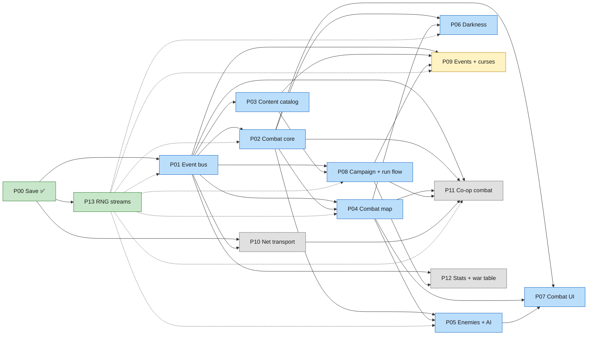
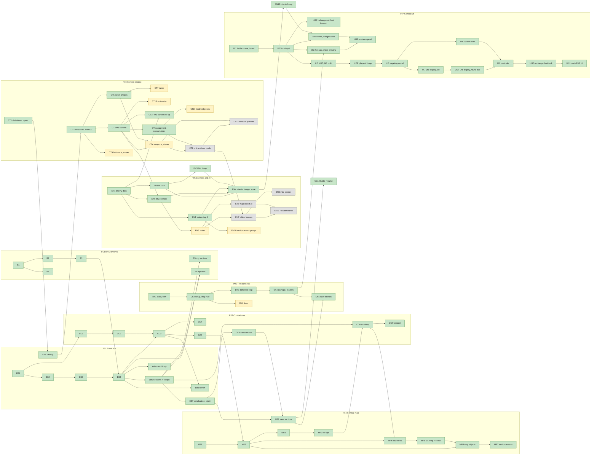

# Orchestrator: dependencies and gates

What each plan and step needs before it can start. Part of the [orchestrator](../game-orchestrator.md). Check a step's row in Gates before sending its prompt.

## Dependency graph

Two views, both updated with every status change: plans (edges follow the registry's *Depends on*
column) and the build steps of the plans in progress. Colors: **green** implemented · **blue** in
progress · **yellow** ready to start (or to draft) · **grey** waiting · **white** post-MVP or not
yet planned.

### Plans

Dotted edges are P13's streams: every plan that rolls draws through them.

### Build steps in progress

Docs steps (EB8, CC9, MP9, R7) are left out. An edge from outside a plan's box is a gate in
[Gates](dependencies.md#gates).

`CC6 --- MP4`: built together; MP4's objective checks run on CC6's `AFTER_STEP` hook.

## Gates

Implementation steps that must wait for another plan. A gate opens when its condition is met;
mark it **Open** here.

| Step | Waits for | Why | Status |
|------|-----------|-----|--------|
| P01 EB1 Facts and buses | P01 approved | — | **Open** October 26, 2026; implemented |
| P01 EB2–EB4 Values, blocks, engine | P02 drafted and approved ✅ (October 26, 2026); P01 amended with P02's needs N1–N10 ([combat core plan](../2026-10-26-combat-core.md#what-p02-needs-from-p01-eb2eb4)): exact float values, `EffectContext` fields, inline flags, permissions, expiry boundaries, per-map charges, 2RN and one-roll methods on roll sources, a sandbox hook for `CombatState`. The phase-side gap is settled by P02 step CC1. P01 amended ✅ (October 26, 2026; [Amendments from P02 and P13](../2026-10-23-event-bus-and-effects.md#amendments-from-p02-and-p13), P01 questions 17–18) | Damage stages, stat sheets, forecasts, rolls and AI simulation sit on both sides | **Open** October 26, 2026 (EB2 and EB3 built; EB4 also needed the live-rolls row below, now open) |
| P01 EB5 Catalog and content tests | P03 CT1 merged (the definition classes and the `res://data/` layout; P03 approved October 29, 2026) | The catalog's typed lookups and layout follow the content kinds | **Open** October 29, 2026 (CT1 merged); implemented October 29, 2026 |
| P01 EB4 live rolls (within EB2–EB4) | P13 approved ✅ (October 26, 2026); P13 R1–R3 implemented ✅ (`RngStream` is what `LiveRolls` wraps); P01 amended with P13's needs R-N1 and R-N2 ✅ (October 26, 2026) ([RNG plan](../2026-10-26-rng-streams.md#what-p13-needs-from-other-plans)) | Real resolution and P02's golden-log tests need seeded streams | **Open** October 26, 2026 (R1–R3 built) |
| P01 EB6 Sessions, encounter, bridge | P04 approved ✅ (October 27, 2026; including P13 need R-N5: stable container indices); P08 question 1 (`CampaignSession` owner) answered ✅ (October 27, 2026: `CampaignService`); P13 approved and P01 amended with R-N3 ✅ (the encounter draws the whole setup once; sessions get their own streams) | Sessions carry turns, deployment, commands and the RNG injection point | **Open** October 27, 2026; implemented with fix-ups October 28, 2026 |
| P01 EB7 Serialization, rejoin | EB6; P01 amended with P13 need R-N4 ✅ (run seed, build and live stream states in snapshots and repro dumps) | — | **Open** October 28, 2026 (EB6 implemented); implemented October 30, 2026 |
| P02 implementation (CC2–CC7; CC6 waits on EB6) | P01 EB4 implemented ✅ (October 26, 2026); EB6 implemented ✅ (October 28, 2026), so CC6 may start | Combat rules are effect-engine consumers | **Open** October 26, 2026; CC2–CC5 built October 27, 2026; CC6 built October 28, 2026, so CC7 may start; CC7 built October 29, 2026 |
| P01 EB9 Benchmark | P02 CC3 (a real `CombatState` and exchange to measure) | Sandbox creation cost means little on the fake test state; the numbers decide copy on write and the AI's branch budget | **Open** October 27, 2026 (CC3 built); implemented October 27, 2026 |
| P02 CC8 Save section | P01 EB7 ✅ (October 30, 2026) | `combat_state` capture builds on EB7's capture and restore helpers | **Open** October 30, 2026 |
| P13 R5 `rng` save sections | P08 question 1 ✅; P01 EB6 implemented ✅ (October 28, 2026; `CampaignService` registers them) | The sections belong to the autoload that owns the streams | **Open** October 28, 2026; implemented October 29, 2026 |
| P03 CT1 Definitions and layout | P03 approved ✅ (October 29, 2026) | — | **Open** October 29, 2026; implemented October 29, 2026 |
| P03 CT2 onward | P01 EB5 implemented ✅ (October 29, 2026) | Content is catalog data; the loadout reads the catalog | **Open** October 29, 2026 |
| P05 EN1–EN4 | P05 approved ✅ (October 30, 2026); P02 and P04 implemented for M1 ✅ | The AI plays P02's commands on P04's maps | **Open** October 30, 2026 |
| P05 EN5 M1 enemies | P05 EN1; P03 CT3 (the Simple Axe, Simple Bow and Minor Heal as data) | Enemies carry the player's generic weapons | **Open** October 30, 2026 (CT3 merged) |
| P06 DK1–DK4 | P06 approved ✅ (November 3, 2026); P02 and P04 implemented for M1 ✅ | The darkness plugs into P02's hooks and P04's map | **Open** November 3, 2026 |
| P06 DK5 Save section | P06 DK4 ✅ (November 4, 2026); P04 MP8 ✅ (November 3, 2026); P02 CC10 ✅ (November 5, 2026) | Built on MP8's section pattern | **Open** November 5, 2026; DK5 built ✅ (November 7, 2026) |
| P07 UI1–UI5 | P07 approved ✅ (November 4, 2026); P02, P04 and P05 implemented for M1 ✅; DK4 for UI3's darkness preview | The UI reads the session and issues commands | **Open** November 4, 2026; UI1–UI5F built ✅ (November 5, 2026) |
| P07 UI6–UI11 (M2) | P07 M1 part built ✅ (November 5, 2026); questions 20–26 answered ✅ (November 5, 2026) | Built in order: UI6's target list first, so controller support (UI9) stays small | **Open** November 5, 2026; UI6 built ✅ (November 5, 2026); UI7, UI7F and UI8 built ✅ (November 6, 2026); UI9, UI10 and UI11 built ✅ (November 7, 2026): M2's part done |
| P14 O3 UI layout | P14 O2 done; no open feature branches or worktrees; a clean tree | About 165 files move, so any open branch would conflict | **Open** November 9, 2026; built ✅ (November 9, 2026) |
| P14 O4 Tests | P14 O3 ✅ (November 9, 2026); no open branch touching `tests/` or `tools/run_tests.sh` | Test files move and the runner changes | **Open** November 9, 2026; built ✅ (November 12, 2026) |
| P08 RN1–RN5 Run loop | P08 approved ✅ (November 12, 2026); built in order | Runs on M1's data; RN2 and RN3 change the save format | **Open** November 12, 2026; RN1 built ✅ (November 12, 2026); RN2 built ✅ (November 13, 2026) |
| P08 RN6–RN11 Nodes and full run | RN5; the M2 content each row of P08's Work Breakdown names (CT4, CT5, CT7, CT8, CT9, CT13; RN11 also EN7, EN8, EN11 and M2's maps) | Offers need real pools | Waiting |
| P05 EN13 Preview: measure | move-preview.md adopted ✅ (November 12, 2026) | Benchmarks and the equality suite only; no behavior change | **Open** November 12, 2026, alongside Wave A |
| P05 EN14–EN16 Preview re-architecture | EN13; EN6 (Guard and Skirmisher, which the zones must cover); in order, EN15 and EN16 after EN14 | The cache and zones must cover every behavior | Waiting |
| P09 EV1 Outcomes | P09 approved ✅ (November 12, 2026); P08 RN2 | Outcomes apply to `CampaignRunState` | **Open** November 13, 2026 (RN2 merged) |
| P09 EV2, EV3, EV5 | EV1; P08 RN5 (EV2 uses the battle bridge and the loop) | EV2 adds the `events` save section | Waiting |
| P09 EV4 Content, EV6 Docs | EV3; P03 CT4, CT5, CT8, CT9 (curse copies must stack), CT13 | The events name real items, prefixes, curses and units | Waiting |
| P02 CC10 Battle resume | P02 CC8 ✅; P04 MP8 ✅ | Restores the saved sections into a rebuilt battle | **Open** November 3, 2026; built ✅ (November 5, 2026) |
| P04 MP1–MP3, MP6 | P04 approved ✅ (October 27, 2026) | — | **Open** October 27, 2026; MP1–MP3 built October 28, 2026; MP6 built October 29, 2026, so MP7 may start; MP7 built October 29, 2026 |
| P04 MP4 Objectives | P02 CC6 (the `AFTER_STEP` hook) | The checks run on the turn loop's hook; built with CC6 | **Open** October 28, 2026 (EB6 implemented, so CC6 may start); implemented with CC6 October 28, 2026, so MP5 may start |
| P04 MP8 Save sections | P01 EB7, P02 CC8 | `entities` and `combat_map` follow the session snapshot and `combat_state` | **Open** October 31, 2026 (CC8 merged) |
| P11 implementation | P10 implemented, P01 EB7, the per-map battle save format | Co-op needs transport, snapshots and saves | Closed |

## Unowned and cross-cutting dependencies

Things more than one plan needs that no plan clearly owns yet. Each needs an owner before the first
plan that depends on it is approved.

| Dependency | Needed by | Candidate owner | Status |
|------------|-----------|-----------------|--------|
| `CampaignSession` ownership and lifecycle | P01 EB6, P08, P11, P12 | P08 (question 1): the `CampaignService` autoload, built in P01 EB6 | **Owned** October 27, 2026 |
| RNG streams manager (reserved `rng` save keys in campaign and combat) | P01 EB4/EB6, P02, P04–P06, P08, P09, P11 | **P13** (its own plan; answers P08 question 2) | Owned October 26, 2026, not started |
| Modified-item price and scrap formula (from deltas) | P03, P08, P09 | **P03** (P03 question 8; step CT10) | **Owned** October 29, 2026 |
| Exit crash and leak around the effects engine (found building P03 CT1; fixed October 29, 2026). **Cause:** Godot engine issue godotengine/godot#117975: `GDScriptLanguage::finish()` reads an already-freed script at exit (access violation, exit 139), fixed by PR #117991 in 4.8 only; 4.7.2 still has it (#124935). Blocks reading `EffectDefinition`'s enums and helpers triggered it, not the reference cycle as such (still 16 scripts). **Fix:** P01 amendment F18 moves those into the `EffectTerms` leaf (31 scripts naming `EffectDefinition` → 6): 0 crashes in 50 `--check-only` runs on each of two scripts that crashed 30–45% before, 0/20 content-suite runs, no leak | Every step's verification: a crashing run still exits 139 after a failed check, so verification reads the output for errors, not only the exit code | P01 (question 51): new code names `EffectTerms`; revisit only if a 4.8 upgrade is chosen | **Resolved** October 29, 2026 |
| Per-map battle save format (one battle state per map) | P11 | P11 | Owned, not started |
| Forfeit save change (a campaign's player count can shrink) | P10, P11 | P11 | Owned, not started |
| Archive record gains run score and ladder level (schema bump and migration) | P12, P20 | P12 (score), P20 (ladder) | Owned, not started |
| Map authoring checks (≥ 8 deployment tiles, ≥ 2 darkness source candidates, ≤ 3 powder kegs) | P04, P06 | P04 (P06 adds its check) | Owned, not started |
| Design-doc updates from P01 (EB8: Campaign triggers, Block gained, inline windows) | P01 | P01 EB8 | Owned (per-map phases already written into the design docs October 24, 2026) |

