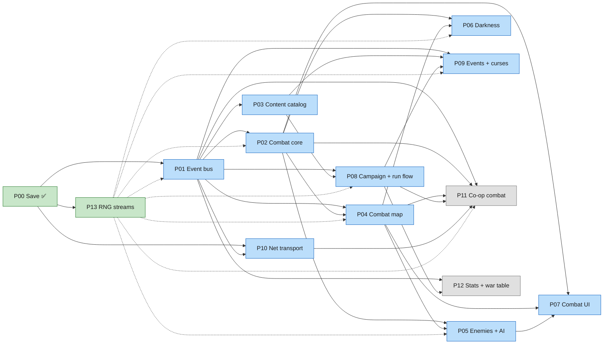
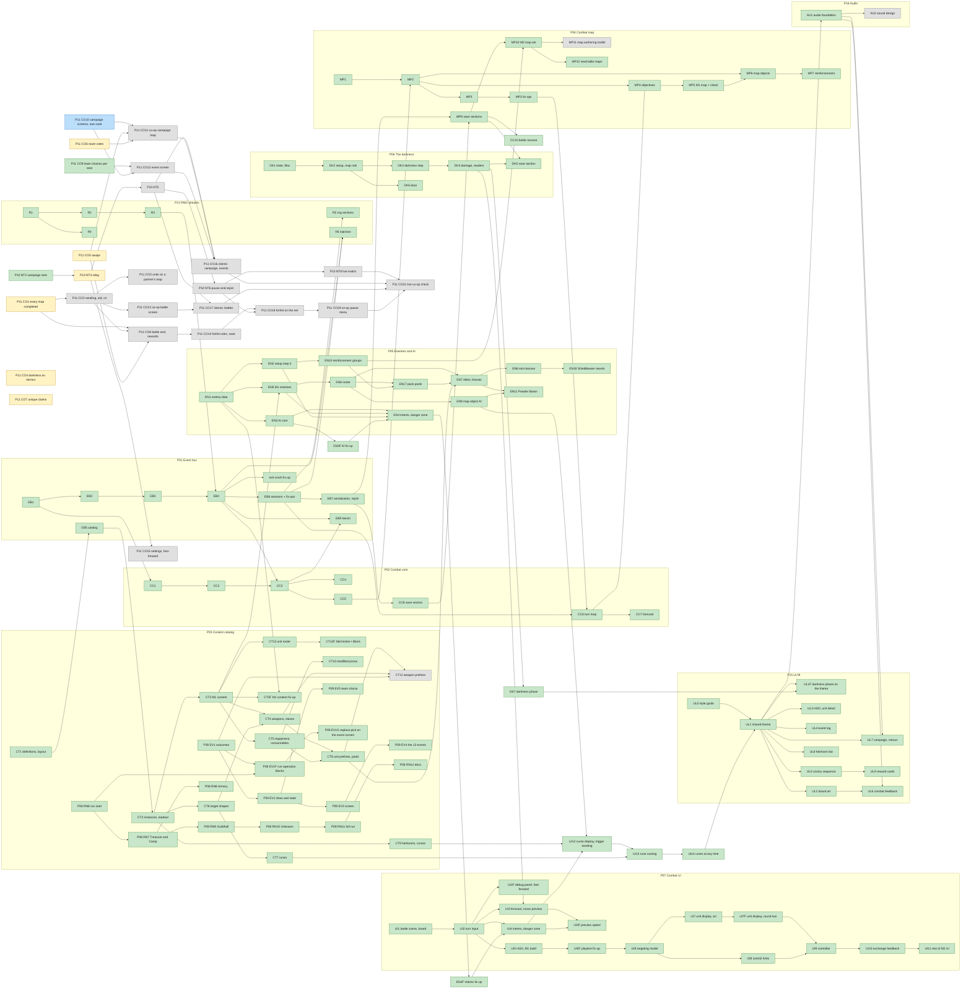

# Orchestrator: dependencies and gates

What each plan and step needs before it can start. Part of the [orchestrator](../game-orchestrator.md). Check a step's row in Gates before sending its prompt.

## Dependency graph

Two views, both updated with every status change: plans (edges follow the registry's *Depends on*
column) and the build steps of the plans in progress. Colors: **green** implemented · **blue** in
progress · **yellow** ready to start (or to draft) · **grey** waiting · **white** post-MVP or not
yet planned.

### Plans

Dotted edges are P13's streams: every plan that rolls draws through them.

### Build steps in progress

Docs steps (EB8, CC9, MP9, R7) are left out. An edge from outside a plan's box is a gate in
[Gates](dependencies.md#gates).

`CC6 --- MP4`: built together; MP4's objective checks run on CC6's `AFTER_STEP` hook.

## Concurrency lanes

Adopted November 19, 2026 (user). Up to **four builds** run at once, **one per lane**, plus any
number of Lane F sessions (docs and plans, no full test run). Every prompt names its lane, the
files it owns, the shared files it may only append to, and what it must not touch.

| Lane | Owns | Steps |
|------|------|-------|
| **A** Battle UI | `ui/battle/**`, `battle_controller.gd`, `battle_screen.gd`, the hint bar, `gameplay.tscn` | UL2, UL6 |
| **B** Campaign and run | `scripts/campaign/`, `campaign_session.gd`, `ui/campaign/` (not `events/`), `SceneRouter` | RN6, UL7, RN7, RN8, RN9, RN10, RN11 |
| **C** Events | `scripts/events/`, `data/events/`, `ui/campaign/events/`, `tests/events/` | EV1–EV6 |
| **D** Engine, AI, content | `scripts/enemies/`, `scripts/effects/`, `data/` content | EN13–EN16, CT12 |
| **E** Network | the net scripts and `SteamNetwork` | P10 |
| **G** Audio and tooling | `scripts/audio/`, `data/audio/`, `tools/`, the runner | AU1, P14 O8 |
| **F** Docs and plans | `docs/` only | the M2 docs batch, plans (P10, P11, P12), ideation |

**Shared, append only:** `project.godot` (input actions, autoloads), `save-system.md` rows. Since
O8 (November 19, 2026) no build edits a suite's `run_all.gd`: a new case file declares
`const SUITE`. Since O8b (November 19, 2026) no build edits `capture_screens.gd`: a UI step adds
its own `tools/captures/<number>_<name>.gd` group.

**Process rules:**

- **Records are the orchestrator's.** Build agents don't edit `game-orchestrator.md`,
  `orchestrator/*`, the bug tracker, `rebalance-and-features.md` or `ui-lift.md`; they put proposed
  entries in their report. A prompt that expects a decision row assigns its question number.
- **Agents merge `dev` into their branch** before their final full run and resolve their own
  conflicts; the orchestrator's full run at merge stays the gate.
- **Shared cores (16):** while iterating, agents run only the suites they touch. The final full
  run uses `JOBS=8 SUITE_TIMEOUT=450` while other builds are active.
- **Merges** go one at a time, in the order reports arrive.

## Gates

Implementation steps that must wait for another plan. A gate opens when its condition is met;
mark it **Open** here.

| Step | Waits for | Why | Status |
|------|-----------|-----|--------|
| P01 EB1 Facts and buses | P01 approved | — | **Open** October 26, 2026; implemented |
| P01 EB2–EB4 Values, blocks, engine | P02 drafted and approved ✅ (October 26, 2026); P01 amended with P02's needs N1–N10 ([combat core plan](../2026-10-26-combat-core.md#what-p02-needs-from-p01-eb2eb4)): exact float values, `EffectContext` fields, inline flags, permissions, expiry boundaries, per-map charges, 2RN and one-roll methods on roll sources, a sandbox hook for `CombatState`. The phase-side gap is settled by P02 step CC1. P01 amended ✅ (October 26, 2026; [Amendments from P02 and P13](../2026-10-23-event-bus-and-effects.md#amendments-from-p02-and-p13), P01 questions 17–18) | Damage stages, stat sheets, forecasts, rolls and AI simulation sit on both sides | **Open** October 26, 2026 (EB2 and EB3 built; EB4 also needed the live-rolls row below, now open) |
| P01 EB5 Catalog and content tests | P03 CT1 merged (the definition classes and the `res://data/` layout; P03 approved October 29, 2026) | The catalog's typed lookups and layout follow the content kinds | **Open** October 29, 2026 (CT1 merged); implemented October 29, 2026 |
| P01 EB4 live rolls (within EB2–EB4) | P13 approved ✅ (October 26, 2026); P13 R1–R3 implemented ✅ (`RngStream` is what `LiveRolls` wraps); P01 amended with P13's needs R-N1 and R-N2 ✅ (October 26, 2026) ([RNG plan](../2026-10-26-rng-streams.md#what-p13-needs-from-other-plans)) | Real resolution and P02's golden-log tests need seeded streams | **Open** October 26, 2026 (R1–R3 built) |
| P01 EB6 Sessions, encounter, bridge | P04 approved ✅ (October 27, 2026; including P13 need R-N5: stable container indices); P08 question 1 (`CampaignSession` owner) answered ✅ (October 27, 2026: `CampaignService`); P13 approved and P01 amended with R-N3 ✅ (the encounter draws the whole setup once; sessions get their own streams) | Sessions carry turns, deployment, commands and the RNG injection point | **Open** October 27, 2026; implemented with fix-ups October 28, 2026 |
| P01 EB7 Serialization, rejoin | EB6; P01 amended with P13 need R-N4 ✅ (run seed, build and live stream states in snapshots and repro dumps) | — | **Open** October 28, 2026 (EB6 implemented); implemented October 30, 2026 |
| P02 implementation (CC2–CC7; CC6 waits on EB6) | P01 EB4 implemented ✅ (October 26, 2026); EB6 implemented ✅ (October 28, 2026), so CC6 may start | Combat rules are effect-engine consumers | **Open** October 26, 2026; CC2–CC5 built October 27, 2026; CC6 built October 28, 2026, so CC7 may start; CC7 built October 29, 2026 |
| P01 EB9 Benchmark | P02 CC3 (a real `CombatState` and exchange to measure) | Sandbox creation cost means little on the fake test state; the numbers decide copy on write and the AI's branch budget | **Open** October 27, 2026 (CC3 built); implemented October 27, 2026 |
| P02 CC8 Save section | P01 EB7 ✅ (October 30, 2026) | `combat_state` capture builds on EB7's capture and restore helpers | **Open** October 30, 2026 |
| P13 R5 `rng` save sections | P08 question 1 ✅; P01 EB6 implemented ✅ (October 28, 2026; `CampaignService` registers them) | The sections belong to the autoload that owns the streams | **Open** October 28, 2026; implemented October 29, 2026 |
| P03 CT1 Definitions and layout | P03 approved ✅ (October 29, 2026) | — | **Open** October 29, 2026; implemented October 29, 2026 |
| P03 CT2 onward | P01 EB5 implemented ✅ (October 29, 2026) | Content is catalog data; the loadout reads the catalog | **Open** October 29, 2026 |
| P05 EN1–EN4 | P05 approved ✅ (October 30, 2026); P02 and P04 implemented for M1 ✅ | The AI plays P02's commands on P04's maps | **Open** October 30, 2026 |
| P05 EN5 M1 enemies | P05 EN1; P03 CT3 (the Simple Axe, Simple Bow and Minor Heal as data) | Enemies carry the player's generic weapons | **Open** October 30, 2026 (CT3 merged) |
| P06 DK1–DK4 | P06 approved ✅ (November 3, 2026); P02 and P04 implemented for M1 ✅ | The darkness plugs into P02's hooks and P04's map | **Open** November 3, 2026 |
| P06 DK5 Save section | P06 DK4 ✅ (November 4, 2026); P04 MP8 ✅ (November 3, 2026); P02 CC10 ✅ (November 5, 2026) | Built on MP8's section pattern | **Open** November 5, 2026; DK5 built ✅ (November 7, 2026) |
| P07 UI1–UI5 | P07 approved ✅ (November 4, 2026); P02, P04 and P05 implemented for M1 ✅; DK4 for UI3's darkness preview | The UI reads the session and issues commands | **Open** November 4, 2026; UI1–UI5F built ✅ (November 5, 2026) |
| P07 UI6–UI11 (M2) | P07 M1 part built ✅ (November 5, 2026); questions 20–26 answered ✅ (November 5, 2026) | Built in order: UI6's target list first, so controller support (UI9) stays small | **Open** November 5, 2026; UI6 built ✅ (November 5, 2026); UI7, UI7F and UI8 built ✅ (November 6, 2026); UI9, UI10 and UI11 built ✅ (November 7, 2026): M2's part done |
| P14 O3 UI layout | P14 O2 done; no open feature branches or worktrees; a clean tree | About 165 files move, so any open branch would conflict | **Open** November 9, 2026; built ✅ (November 9, 2026) |
| P14 O4 Tests | P14 O3 ✅ (November 9, 2026); no open branch touching `tests/` or `tools/run_tests.sh` | Test files move and the runner changes | **Open** November 9, 2026; built ✅ (November 12, 2026) |
| P08 RN1–RN5 Run loop | P08 approved ✅ (November 12, 2026); built in order | Runs on M1's data; RN2 and RN3 change the save format | **Open** November 12, 2026; RN1 built ✅ (November 12, 2026); RN2 built ✅ (November 13, 2026); RN3 built ✅ (November 13, 2026); RN4 built ✅ (November 14, 2026); RN5 built ✅ (November 15, 2026) |
| P08 RN6–RN11 Nodes and full run | RN5 ✅ (November 15, 2026); **RN6 ✅** (merged November 19, 2026: the starting heirloom offer, the seven starting heirlooms, `RunOperations`). **RN7 ✅** (merged November 19, 2026: Treasure, Camp (Feast, cooking, Train, re-gear), the army view (view-and-scrap from the map on `unit_detail`, re-gear at a Camp, "Army n / max"), the key combat's heirloom, co-op gifting at Camps headless; `Screen.TREASURE = 14`, `CAMP = 15`; `CampaignFact.Kind` 25–26; P08 questions 34–42). **RN8 ✅** (merged November 20, 2026: the Armory, its rolled and saved stock in `run_flow.shop_stock`, buying onto a unit with trade-in, the shop keys read, co-op headless; `Screen.ARMORY = 16`; `CampaignFact.Kind` 27–28 and `FLAG_BOUGHT = 1`; `FactCueMap.Shape.BOUGHT = 8`; P08 questions 43–54). **RN9 ✅** (merged November 20, 2026, 7,170 cases: the Guildhall (3 recruits, 2 runes, prefix re-rolls, the hand-over), BUG-014 fixed (runes carried into battles and written back); `Screen.GUILDHALL = 17`; `CampaignFact.Kind` 29–31; `FactCueMap.Shape.GUILDHALL_NODE = 9`; `CampaignSession.Army.rune_slots`, `BattleResult.runes`; P08 questions 55–63). **RN10 ✅** (merged November 20, 2026, 7,215 cases: the Unknown rolled on entry at the vision's rising odds, saved in `run_flow.unknown` and `unknown_odds`; each outcome plays as its real node through `CampaignRunState.node_type()`; `CampaignFact.Kind` 32; the placeholder kept only as the fallback for an event with nothing eligible; P08 questions 64–67). **RN11 issued** November 20, 2026 (Lane B), before NT3 (user). RN7's Train is `RunOperations.upgrade`; RN9 closes `campaign_run_state.gd` TOD-001's recruit grants with `RunOperations.recruit`, and is the first place a raised max army size (Muster Roll, Abundance's +1) can be filled after run start (user noticed Muster Roll has no visible effect, November 19, 2026; RN7's army view shows "Army n / max"); RN7 and RN8 read `SCRAP_PERCENT` and the shop keys on the campaign layer (docs batch: today they're read only in battle); RN10 calls `EventNode.open()` when the Unknown roll is an event and falls back to the placeholder on a rejection (EV2); the M2 content each row of P08's Work Breakdown names (CT4, CT5, CT7, CT8, CT9, CT13, and CT13F ✅ (November 15, 2026) before RN7; RN11 also EN7, EN8, EN11 and P04 MP10, the M2 map set). **RN11 ✅** (merged November 20, 2026, 7,241 cases: a seeded solo run played headless to the Boss and resumed at every stop matches the straight run (`tests/ui/campaign/full_run_cases.gd`); every pool and pack checked over a run; heirloom and curse carriers made at each Begin and dropped at the battle's end (BUG-031); P08 questions 68–70) | Offers need real pools | **Done**; RN12 ✅ (merged November 21, 2026: campaign-run.md, save-system.md's run state, BUG-029; P08 question 71): P08 complete |
| P03 CT14 Vanguard rework | The user's change (November 19, 2026; RF-030) | A new `LevelOf` value source (`subject`, `per_level`); `SandboxState.level_of()`; the Drengr's data | **Done**: merged November 19, 2026 (P03 question 34 answered: the "×" text and the `per_level` name) |
| P05 EN13 Preview: measure | move-preview.md adopted ✅ (November 12, 2026) | Benchmarks and the equality suite only; no behavior change | **Done**: merged November 20, 2026: the bench (debug and release), the profile, the `enemies/preview` equality part (10 seeded boards, 812 tiles), `Intents.is_checking`; P05 question 47. The 50 ms target holds only on M1 turn 1 (hover p95: key board 528 ms, boss board 2,331 ms in debug); attack forecasts are 85–99% of a decision and nothing is reused on 9-enemy boards |
| P05 EN14–EN16 Preview re-architecture | EN13; EN6 ✅ (November 13, 2026; Guard and Skirmisher, which the zones must cover); in order, EN15 and EN16 after EN14 | The cache and zones must cover every behavior; EN15 also stops re-planning the Shieldbearer on every move preview (EN6 report) | **EN14 ✅** (merged November 20, 2026, 7,260 cases): the forecast cache (`EnemyAI.ForecastStore`, `Forecasts`; one store per computation of the intents, previews add up to 2,000; P05 question 48) and a lighter sandbox copy (`StatSheet.copy_for`). Hover p95 in debug: M1 engaged 107 → 46 ms, key 503 → 300 ms, boss 1,860 → 970 ms: the 50 ms target holds on the M1 boards, not on the 9-enemy ones, where the decisions and their floods now cost most. **EN15 ✅** (merged November 21, 2026, 7,472 cases): preview zones (layer 3, `EnemyAI.Footprint`; changed tiles found by comparing facts) and the incremental danger zone (layer 4). Hover p95 in debug: key 384 → 296 ms, boss 1,043 → 956 ms; the zones keep few decisions on engaged boards (3–15% on a first step), so the sweep must carry the hover target. P05 questions 49–51 open. **EN16 ready** (Lane A, after BF7: it changes `ui/battle/board/move_preview.gd` and the battle controller); BUG-035 goes with it |
| P09 EV1 Outcomes | P09 approved ✅ (November 12, 2026); P08 RN2 | Outcomes apply to `CampaignRunState` | **Done**: merged November 19, 2026 (13 outcome blocks with the CT12 weapon-prefix block, `EventRequirements`, `EventResolver`; `CampaignFact.Kind` 10–15 appended, P09 question 7) |
| P09 EV1F Recruit, upgrade and max army size blocks | EV1 ✅; P08 RN6 (builds those run operations in `scripts/campaign/`, and the army-size read; P08 question 29). EV1F also adds the saved seat-level value changes for event army-size changes (Company Charter): a list in the `heirlooms` section, version 1 → 2 with a no-op migration (🔴 save) | Both lanes needed the same operations. EV1 left four TOD-001 markers: the three blocks (`event_outcome.gd`), a revive into a full army (`revive_outcome.gd`, needs RN6's replace-a-unit), the per-seat max army size behind the Charter requirement (`event_requirements.gd`), the healing-received percent handed in (`event_context.gd`; EV2 passes 100, so Cursed Blood doesn't halve event heals until the campaign layer reads heirloom values) | **Done**: merged November 20, 2026 (6,893 cases): the recruit, upgrade and max army size blocks; `EventChoice.replaced_id` for a recruit or revive into a full army; event heals read `RunOperations.healing_received_percent` (Cursed Blood halves them); `heirlooms` v2 with `SeatRun.value_changes`, which `max_army_size` reads (so RN9's room check sees event growth); P09 questions 37–42 |
| P09 EV1G Replace pick on the event screen | EV1F ✅; EV3 ✅ | EV1F added `EventChoice.replaced_id` but the screen has no "which unit leaves?" step: a recruit into a full army is refused with its reason, and the fallen chooser greys every unit while the army is full (question 35) | **Done**: merged November 20, 2026: `EventPanel.Step.LEAVING = 8`, reusing `EventChooser`; a revive picks the fallen unit, then the one that leaves; unsaved, like placements; P09 questions 60–62 |
| P09 EV2, EV3, EV5 | EV1 ✅ (November 19, 2026); P08 RN5 ✅; **EV2 ✅** (merged November 19, 2026: the `events` section, CAMPAIGN v1; `EventNode.open()` for RN10, `EventNode.view()` / `open_chooser()` / `choose()` for EV3; `CampaignFact.Kind` 16–18) | EV2 adds the `events` save section; it fills `EventRolls.curse_id` (the tier draw) and the rare heirloom, saves `EventRolls`, and calls `EventResolver.roll` when the event is made (EV1 report) | **Open**: EV5 ✅ (merged November 19, 2026: votes, the weighted TEAM_CHOICE draw, every-seat requirements; `EventNode.vote()`, the view's `is_team_vote`, `votes`, `drawn`, `vote_count`; `CampaignFact.Kind` 19–20). **EV3 ✅** (merged November 19, 2026: the event screen, `Screen.EVENT = 13`, the routing gaps closed; P09 questions 27–36). **EV4 ready** (Lane C): an option's `text` is what its card shows as its outcomes. EV3 also routes an open event to the event screen in `run_screen.gd` (today both go to the placeholder), and takes `ui/campaign/run_screen.gd`'s routing of an Unknown node with a pending surprise combat to the battle screen (EV2 estimate) |
| P09 EV4 Content, EV6 Docs | EV3; P03 CT4, CT5, CT8, CT9 (curse copies must stack), CT13 | The events name real items, prefixes, curses and units | **EV4 ✅** (merged November 20, 2026, 7,038 cases: the 13 events in `data/events/`, `goblet_infusion.tres` (BUG-021), nine Godot_FE backgrounds, `EffectCatalog` skips `data/events/`; P09 questions 43–50). **EV6 ✅** (merged November 20, 2026: events.md's ids and rule readings, save-system.md's events and heirlooms rows, the 450 capture group on real events; P09 questions 63–65). **P09 complete.** |
| P03 CT12 Weapon modifications | P09 EV1 (the outcome blocks); P03 question 33 | Weapons never generate with a prefix; only events and later run sources apply one | Waiting on EV1 |
| P02 CC10 Battle resume | P02 CC8 ✅; P04 MP8 ✅ | Restores the saved sections into a rebuilt battle | **Open** November 3, 2026; built ✅ (November 5, 2026) |
| P04 MP1–MP3, MP6 | P04 approved ✅ (October 27, 2026) | — | **Open** October 27, 2026; MP1–MP3 built October 28, 2026; MP6 built October 29, 2026, so MP7 may start; MP7 built October 29, 2026 |
| P04 MP4 Objectives | P02 CC6 (the `AFTER_STEP` hook) | The checks run on the turn loop's hook; built with CC6 | **Open** October 28, 2026 (EB6 implemented, so CC6 may start); implemented with CC6 October 28, 2026, so MP5 may start |
| P04 MP8 Save sections | P01 EB7, P02 CC8 | `entities` and `combat_map` follow the session snapshot and `combat_state` | **Open** October 31, 2026 (CC8 merged) |
| P10 NT1–NT8 Net transport | P10 approved ✅ (November 19, 2026); in order NT1, then NT2 and NT3 in parallel, then NT4–NT8 | Cross-lane edits per the plan's "Other lanes' files" column (P10 question 12): NT3 touches Lanes B and C, NT5 `battle_controller.gd` (Lane A), NT6 `scene_router.gd` (Lane B); schedule each when those lanes are quiet | **Open**: NT1 ✅ (merged November 19, 2026: `NetGate`, `NetContract` (the build fingerprint, about 164 ms at boot), `BUILD_MISMATCH = 3`, `SeatDirectory`, the `tests/net/` suite; P10 questions 15–18). NT2 ✅ (merged November 19, 2026: the loopback harness, `tests/net/harness/net_harness.gd`, plus one ENet case; P10 questions 19–21 answered as recommended). NT3 ✅ (merged November 21, 2026, 7,405 cases: wire forms for all 22 campaign and event commands and `CampaignBatch`, the fingerprint covers their names; P10 questions 22–24). NT4 ready (Lane E): P11 question 4 answered (user, November 21, 2026): its host route calls `complete_on_host(session)` on each decoded campaign command, each command filling its own host-side objects (NT3 found no such path today). P11 question 1 also answered: NT5 binds the battle and campaign map screens to a client's own seat. Before NT3: NT3 gives every campaign and event command a wire form; EV4 is event data and EV1G event UI, neither edits commands); NT4 needs NT3 |
| P11 CO1–CO14 | P11 approved ✅ (user, November 20, 2026); each step's questions answered (the first steps' are); no NT step (CO10 and CO12 rely on P11 questions 2 and 3 (a)) | Lane plan: D CO1 → CO2 → CO3, CO4 any time; B CO10 → CO5 → CO7 → CO8 → CO11 → CO14; C CO9 → CO6 → CO12 (CO6 moved to Lane C, user); A CO13 after CO2 | **Open**: CO9 ✅ (merged November 21, 2026: each seat applies a team option with its own picks; BUG-025; P11 questions 50–52 open); CO10 building (B); CO1, CO4 (D), CO5, CO7 (B), CO6 (C) ready; CO12 after CO10 and TX3; CO13 after CO2 |
| P11 CO15 | P10 NT4 | Seat settings and fast-forward on the network (Lane E) | Closed |
| P11 CO16, CO17 | P10 NT5 | Clients in the harness: campaign and events (CO16), battles (CO17) | Closed |
| P11 CO18, CO19 | P10 NT6 | Forfeit and removal on the network; the co-op pause menu | Closed |
| P11 CO21 | P10 NT8; CO16–CO19 | The live co-op check (M4) | Closed |

## Unowned and cross-cutting dependencies

Things more than one plan needs that no plan clearly owns yet. Each needs an owner before the first
plan that depends on it is approved.

| Dependency | Needed by | Candidate owner | Status |
|------------|-----------|-----------------|--------|
| `CampaignSession` ownership and lifecycle | P01 EB6, P08, P11, P12 | P08 (question 1): the `CampaignService` autoload, built in P01 EB6 | **Owned** October 27, 2026 |
| RNG streams manager (reserved `rng` save keys in campaign and combat) | P01 EB4/EB6, P02, P04–P06, P08, P09, P11 | **P13** (its own plan; answers P08 question 2) | Owned October 26, 2026, not started |
| Modified-item price and scrap formula (from deltas) | P03, P08, P09 | **P03** (P03 question 8; step CT10) | **Owned** October 29, 2026 |
| Exit crash and leak around the effects engine (found building P03 CT1; fixed October 29, 2026). **Cause:** Godot engine issue godotengine/godot#117975: `GDScriptLanguage::finish()` reads an already-freed script at exit (access violation, exit 139), fixed by PR #117991 in 4.8 only; 4.7.2 still has it (#124935). Blocks reading `EffectDefinition`'s enums and helpers triggered it, not the reference cycle as such (still 16 scripts). **Fix:** P01 amendment F18 moves those into the `EffectTerms` leaf (31 scripts naming `EffectDefinition` → 6): 0 crashes in 50 `--check-only` runs on each of two scripts that crashed 30–45% before, 0/20 content-suite runs, no leak | Every step's verification: a crashing run still exits 139 after a failed check, so verification reads the output for errors, not only the exit code | P01 (question 51): new code names `EffectTerms`; revisit only if a 4.8 upgrade is chosen | **Resolved** October 29, 2026 |
| Per-map battle save format (one battle state per map) | P11 | P11 CO2 (`combat_state` 3 → 4; P11 questions 15 and 40): the battle save already holds every map's units, turn and phase | Owned, not started |
| Forfeit save change (a campaign's player count can shrink) | P10, P11 | P11 CO14 and CO18; the archive bump to schema 2 is ordered with P12's planned bump | Owned, not started |
| Archive record gains run score and ladder level (schema bump and migration) | P12, P20 | P12 (score), P20 (ladder) | Owned, not started |
| Map authoring checks (≥ 8 deployment tiles, ≥ 2 darkness source candidates, ≤ 3 powder kegs) | P04, P06 | P04 (P06 adds its check) | Owned, not started |
| Design-doc updates from P01 (EB8: Campaign triggers, Block gained, inline windows) | P01 | P01 EB8 | Owned (per-map phases already written into the design docs October 24, 2026) |

